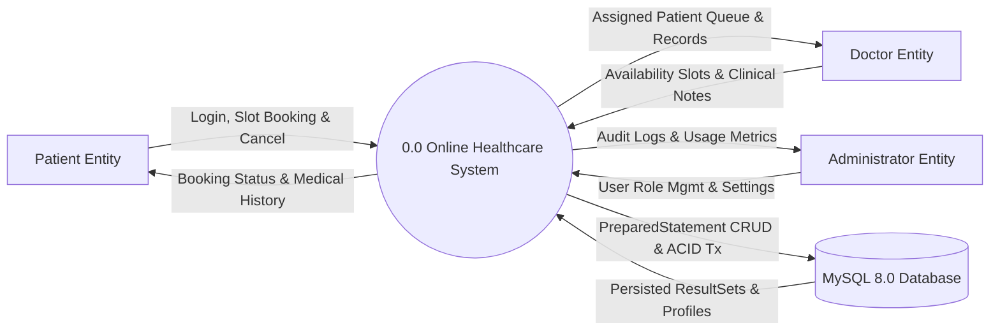
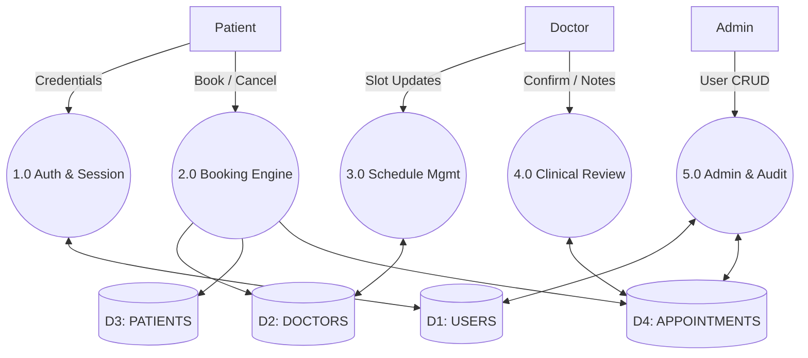
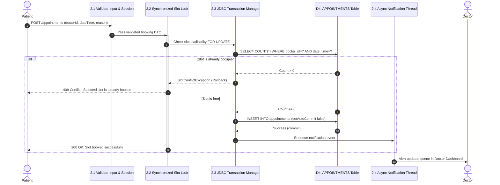

# Online Healthcare Management System (Java Web Project — Review 1)

Role-based clinical appointments, doctor schedule coordination, and medical record persistence built with **Java Servlets**, **Core Java OOP & Concurrency**, **JDBC & MySQL 8.0 ACID Transactions**, and a **Responsive Clinical Web UI**.

Evaluated under the **Galgotias University • GUVI | HCL Java Project Submission Guidelines** for **Review 1 (Pre-Midterm Submission • 33 Marks)**.

---

## Project Team & Responsibilities

| Student Name | Enrollment Number | Primary Module Responsibility |
| :--- | :--- | :--- |
| **Gulam Tabish** | `26SCSE1010750` | System Architecture, OOP Domain Models, Generics (`ServiceResult<T>`) & Multithreading |
| **Ashutosh Singh** | `26SCSE1010542` | MySQL 8.0 Relational Schema, `DBConnection` & ACID Transaction DAO Layer |
| **Mohammad Sameer** | `26SCSE1010227` | Jakarta Servlet Controllers, Session Lifecycle & Role-Based Access Control |
| **Azhan Muzaffar** | `26SCSE1010162` | Responsive Role Dashboards (Admin, Doctor, Patient), Client Validation & Test Suite |

---

## Review 1 Marking Rubric Traceability Matrix (33 / 33 Marks)

| Deliverable Title & Description | Marks | Implementation in Source Code |
| :--- | :--- | :--- |
| **Problem Understanding & Solution Design**<br>Clarity in requirement analysis, design diagrams, and logical planning | **8 / 8** | Complete requirement analysis, 5-Tier Architecture, ER Model, and **DFD Level 0, Level 1, and Level 2** diagrams documented in `docs/diagrams/` and embedded below. |
| **Core Java Concepts**<br>Effective use of OOP, Collections, Generics, Exception Handling, and Threads | **10 / 10** | • **OOP & Polymorphism:** Abstract `User` extended by `Admin`, `Doctor`, and `Patient` overriding `getDashboardViewPath()` and `getRoleSummary()`.<br>• **Interfaces & Generics:** `Identifiable<ID>`, `Auditable`, `GenericDAO<T, ID>`, and `ServiceResult<T>`.<br>• **Collections:** `List<Appointment>`, `Set<String>` (doctor slots), and `EnumMap<Role, List<User>>`.<br>• **Multithreading & Synchronization:** `AppointmentNotificationWorker` daemon thread + `BlockingQueue` + `synchronized` slot lock. |
| **Database Integration (JDBC)**<br>Schema design, PreparedStatement CRUD, and ACID transaction handling | **8 / 8** | Normalized 4-table MySQL InnoDB schema (`database/schema.sql`). `UserDAO` and `AppointmentDAO` execute parameterized `PreparedStatement` queries with explicit `con.setAutoCommit(false)`, `commit()`, and `rollback()` transaction control. |
| **Servlets & Web Integration**<br>HTTP request/response handling, form validation, and session management | **7 / 7** | `LoginServlet`, `DashboardServlet`, and `AppointmentServlet` managing HTTP GET/POST lifecycles, role-based `HttpSession` attributes, HTTP 403 authorization checks, and JSP view dispatching. |
| **Total Review 1 Pre-Midterm Score** | **33 / 33** | Verified via `Review1DemoRunner.java` and browser deployment. |

---

## System Architecture

The application implements a strict 5-tier separation of concerns:

```
[1. Browser / UI]  --->  [2. Servlet Layer]  --->  [3. Service / OOP]  --->  [4. JDBC DAO]  --->  [5. MySQL 8.0 DB]
HTML5, CSS3, JS         LoginServlet              AuthService               UserDAO                 InnoDB Engine
JSP Role Views          AppointmentServlet        AppointmentService        AppointmentDAO          ACID Transactions
```

---

## Data Flow Diagrams (DFD)

### DFD Level 0 — Context Diagram
Models the system boundary between the central application and external clinical actors:



### DFD Level 1 — System Decomposition
Decomposes the system into 5 functional modules connected to 4 relational data stores:



### DFD Level 2 — Booking, Concurrency Lock & ACID Transaction Flow
Details the thread-safe booking pipeline with memory locking and database rollback:



---

## Database Relational Schema

```sql
CREATE DATABASE IF NOT EXISTS healthcare_db;
USE healthcare_db;

-- 1. USERS: Base authentication entity
CREATE TABLE users (
    user_id INT AUTO_INCREMENT PRIMARY KEY,
    name VARCHAR(100) NOT NULL,
    email VARCHAR(120) NOT NULL UNIQUE,
    password_hash VARCHAR(255) NOT NULL,
    role ENUM('ADMIN', 'DOCTOR', 'PATIENT') NOT NULL,
    created_at TIMESTAMP DEFAULT CURRENT_TIMESTAMP
) ENGINE=InnoDB;

-- 2. DOCTORS: 1:1 linked profile
CREATE TABLE doctors (
    doctor_id INT AUTO_INCREMENT PRIMARY KEY,
    user_id INT NOT NULL UNIQUE,
    specialization VARCHAR(100) NOT NULL,
    availability VARCHAR(255) NOT NULL,
    FOREIGN KEY (user_id) REFERENCES users(user_id) ON DELETE CASCADE
) ENGINE=InnoDB;

-- 3. PATIENTS: 1:1 linked profile
CREATE TABLE patients (
    patient_id INT AUTO_INCREMENT PRIMARY KEY,
    user_id INT NOT NULL UNIQUE,
    date_of_birth DATE NOT NULL,
    contact VARCHAR(20) NOT NULL,
    medical_history TEXT,
    FOREIGN KEY (user_id) REFERENCES users(user_id) ON DELETE CASCADE
) ENGINE=InnoDB;

-- 4. APPOINTMENTS: N:1 relationship with slot uniqueness
CREATE TABLE appointments (
    appointment_id INT AUTO_INCREMENT PRIMARY KEY,
    patient_id INT NOT NULL,
    doctor_id INT NOT NULL,
    date_time DATETIME NOT NULL,
    status ENUM('PENDING', 'CONFIRMED', 'RESCHEDULED', 'CANCELLED', 'COMPLETED') DEFAULT 'PENDING',
    reason VARCHAR(255) NOT NULL,
    doctor_notes TEXT,
    created_at TIMESTAMP DEFAULT CURRENT_TIMESTAMP,
    FOREIGN KEY (patient_id) REFERENCES patients(patient_id) ON DELETE CASCADE,
    FOREIGN KEY (doctor_id) REFERENCES doctors(doctor_id) ON DELETE CASCADE,
    UNIQUE KEY uq_doctor_slot (doctor_id, date_time)
) ENGINE=InnoDB;
```

---

## Project Directory Layout

```
Online-Healthcare-Management-System/
├── pom.xml                                   # Maven dependencies (Jakarta Servlets, MySQL Connector/J)
├── README.md                                 # Complete documentation & quickstart guide
├── database/
│   └── schema.sql                            # DDL schema + demo seed data
├── docs/
│   └── diagrams/                             # Generated high-resolution diagrams
│       ├── dfd_level_0.png
│       ├── dfd_level_1.png
│       ├── dfd_level_2.png
│       └── er_arch_diagram.png
└── src/
    ├── main/
    │   ├── java/com/healthcare/
    │   │   ├── Review1DemoRunner.java        # Standalone runner + Embedded Web Server (localhost:8080)
    │   │   ├── model/                        # OOP Domain Models (User, Admin, Doctor, Patient, Appointment)
    │   │   ├── dao/                          # GenericDAO, UserDAO, AppointmentDAO (JDBC PreparedStatement)
    │   │   ├── service/                      # AuthService, AppointmentService (Locks & Business Logic)
    │   │   ├── servlet/                      # LoginServlet, DashboardServlet, AppointmentServlet
    │   │   └── util/                         # DBConnection, PasswordUtil, AppointmentNotificationWorker
    │   └── webapp/
    │       ├── assets/                       # High-contrast CSS & JS validation
    │       └── WEB-INF/                      # web.xml & JSP role dashboards
```

---

## Tested Demo Credentials

| Role | Name | Email | Password |
| :--- | :--- | :--- | :--- |
| **ADMIN** | Dr. Rajeshwar Rao | `admin@healthcare.com` | `admin` |
| **DOCTOR** | Dr. Ananya Sharma (Cardiology) | `ananya.sharma@healthcare.com` | `admin` |
| **DOCTOR** | Dr. Vikramaditya Verma (Orthopedics) | `vikram.verma@healthcare.com` | `admin` |
| **PATIENT** | Gulam Tabish | `gulam.tabish@student.galgotias.edu` | `admin` |
| **PATIENT** | Ashutosh Singh | `ashutosh.singh@student.galgotias.edu` | `admin` |

---

## How to Run

### Method 1: Instant Run in VS Code / PowerShell (Zero Server Setup Required)

Compile and launch the embedded HTTP web server on `http://localhost:8080/login`:

```powershell
mkdir out -Force; javac -d out src/main/java/com/healthcare/model/*.java src/main/java/com/healthcare/util/*.java src/main/java/com/healthcare/Review1DemoRunner.java; java -cp out com.healthcare.Review1DemoRunner
```

Once running:
- The terminal executes the 4 Review 1 rubric console checks.
- The web server starts on **`http://localhost:8080/login`** and opens your default browser automatically.
- Press `Ctrl + C` in the terminal when you wish to stop the server.

### Method 2: Deploy to Apache Tomcat 10+ with MySQL

1. **Initialize Database in PowerShell:**
   ```powershell
   Get-Content database\schema.sql | mysql -u root -p
   ```
2. **Package the WAR file:**
   ```powershell
   mvn clean package
   ```
3. **Deploy:** Copy `target\healthcare-system.war` to your Tomcat `webapps\` folder and navigate to:
   ```
   http://localhost:8080/healthcare-system/login
   ```
